<h1 id="-english"></h1>

  
# Official Documentation: TenshoScripts v2.1.0

Welcome to the **TenshoScripts** manual. This toolkit was created to make your life easier when animating subtitles. Our main focus is to streamline and professionalize the subtitle workflow specifically for **YouTube**. Our engine ensures that your subtitles never break or get displaced while applying complex effects.

---

## 📑 Tool Index

**⚙️ Settings**
* [0. Global Settings](#0-global-settings)

**🟢 Free Tools**
* [1. Adapted Fadeworks](#1-adapted-fadeworks)
* [2. Easy Gradient](#2-easy-gradient-multi-point)
* [3. Flashes](#3-flashes)
* [4. Split Lines](#4-split-lines)
* [5. Transform (\t)](#5-transform-t)
* [6. Text & Fonts FX](#6-text--fonts-fx)
* [7. Fix Lines](#7-fix-lines)
* [8. YtktFade](#8-ytktfade)
* [9. Number Counter](#9-number-counter)
* [10. Shake](#10-shake)
* [11. Color Tracker](#11-color-tracker)

**💎 TenshoScripts + (Exclusive)**
* [12. Dynamic Glitch](#12-dynamic-glitch-paid)
* [13. Rainbow Wave](#13-rainbow-wave-paid)
* [14. KaraFX (Karaoke & ReverseK)](#14-karafx-karaoke--reversek-paid)
* [15. Curves [BETA]](#15-curves-paid---beta)
* [16. Smart Translation](#16-smart-translation-paid)

---

## 0. Global Settings
Where you customize how the script behaves in your Aegisub.

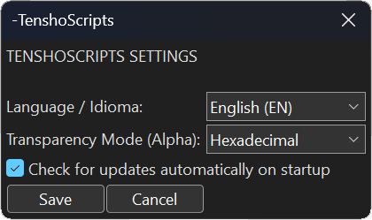

### How the options work:
* **Language / Idioma:** Changes the language of all buttons and warnings (English or Portuguese).
* **Transparency Mode (Alpha):** How you prefer to type transparency values inside the tools. It can be Aegisub's native hexadecimal code (e.g., `&HFF&`) or a simple percentage from `0 to 100%`.
* **Check for updates automatically:** If checked, the script searches the internet every time you open it to see if there are new features and downloads them automatically.

---

## 1. Adapted Fadeworks
Fadeworks makes your text appear and disappear smoothly (Fade In / Fade Out).

### How the buttons work:
* **Fade In / Fade Out:** The time the text takes to fully appear at the beginning and fade out at the end. 
  * *Golden Tip:* Instead of typing milliseconds (e.g., `500`), you can type a decimal value (like `0.8`). This makes the fade last exactly **80% of the line's total time**, no matter its duration!
* **Alpha / Colour:** If you choose **Alpha**, the text will just fade in transparency. If you choose **Colour (From/To)**, the text will crossfade from one color to another as it appears.
* **By Letter:** Instead of the whole line fading at once, each letter will fade in one after the other.
* **Direction:** The order the letters will appear (Left to Right, Right to Left, etc.).

---

## 2. Easy Gradient (Multi-Point)
Paints your subtitle with a horizontal gradient. Works perfectly even if you select multiple lines at the same time.

  <table>
    <tr>
      <td align="center" width="50%">
        <strong>Manual Gradient</strong> 
        
      </td>
      <td align="center" width="50%">
        <strong>Gradient by Style</strong> 
        
      </td>
    </tr>
  </table>

### How the buttons work:
* **Colors (1 to 5):** Choose the colors that will form the gradient. Enable the extra color checkboxes for complex setups.
* **Interpolate HSL:** Keep this checked! It makes the color blending look vibrant, preventing grayish or muddy tones in the middle.
* **Target Checkboxes:** Choose where the color will be applied: Inside the text (`\c`), on the border (`\3c`), or the shadow (`\4c`).
* **Styles Tab:** Tell the script to create a gradient pulling colors straight from your Aegisub Styles (e.g., "Start with Style A's color and end with Style B's color").

---

## 3. Flashes
Makes your subtitle blink rapidly in another color. Perfect for visual impacts synced with heavy music beats.

### How the buttons work:
* **Flash Color:** The color the text will turn into when it "blinks".
* **Interval (ms):** The speed of the blinks. Smaller number = Faster.
* **Smooth Transition:** If unchecked, it cuts abruptly (strobe style). If checked, the color pulses smoothly.
* **Apply to:** Which color receives the flash: fill (`\c`), secondary (`\2c`), border (`\3c`) and/or shadow (`\4c`).

---

## 4. Split Lines
Cuts an entire sentence and turns each letter or word into a separate line without moving them from their original spot.

### How the buttons work:
* **Split by Character:** Separates letter by letter.
* **Split by Word:** Separates cutting at the spaces.

---

## 5. Transform (\t)
Automatically animates changes in colors, sizes, and transparency over time.

### How the buttons work:
* **Start and End (ms):** Defines the exact time the animation happens. If you leave the end at zero, it uses the total line duration.
* **Colors and Size:** Check what you want to change and its final value. (e.g., checking Font `\fs` to `150` makes the text smoothly grow to that size).

---

## 6. Text & Fonts FX
A text animation generator focused on typography.

### Available Effects:
* **Random Fonts:** Rolls random fonts. The script automatically adjusts their size so a naturally small font doesn't look "squeezed" next to a big one.
* **Typewriter:** Makes the text type out on the screen.
* **Unscramble (Hacking):** Shows rolling random symbols before revealing the true letter.
* **Chaos:** The text randomly "corrupts" itself with bizarre symbols throughout the line duration.
* **Invert:** Mirrors the text backwards.
* **Dynamic Jump (Center):** Makes the text constantly re-center itself on the screen with every new letter typed, without pushing the rest of the sentence.

---

## 7. Fix Lines
Converts the selected lines to absolute coordinates (`\pos`) and moves them all to a new position, keeping the distance between them. Useful to reposition a whole group of lines at once.

### How the buttons work:
* **New X / New Y (Anchor):** Where the **reference line** should end up. The reference is the first selected line (or the first one marked as "Original"); its current position is shown below the fields. Every other selected line moves by the same amount, so the layout between them is preserved.
* **Force alignment (`\an5`):** Removes the existing `\an` and sets `\an5` (center) on the lines, so the X/Y you typed is the center of the text.

---

## 8. YtktFade
A tool made exclusively for uploaders who use "invisible" karaoke on YouTube. It prepares the selected lines by adding the `\ytktFade` tag and making the secondary color (`\2a&HFF&`) fully transparent, so the unsung part of the text stays hidden until it is sung.

### How the buttons work:
* **Enable `\2c`:** When checked, also sets the secondary color (`\2c`) to the color chosen next to it. Leave it unchecked to keep the line's current `\2c`.
* You can run it again on the same lines: the previous `\ytktFade` and `\2a` are replaced, not duplicated.

---

## 9. Number Counter
Generates animated numbers automatically. Great for loading bars, statistics, or timers on screen.

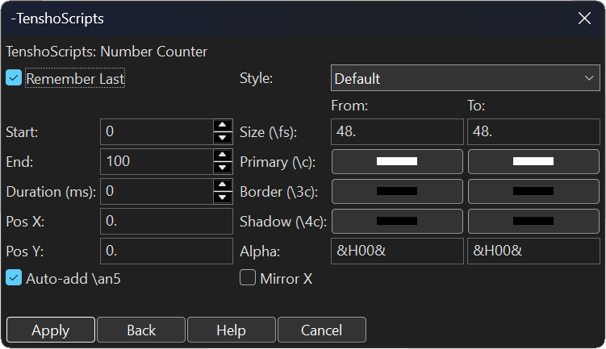

### How the buttons work:
* **Start / End:** Where the number begins and where it stops (e.g., 0 to 100).
* **Duration (ms):** Time it takes to count. If left at `0`, it counts during the entire line duration.
* **Pos X / Pos Y:** The exact coordinates on the screen where the counter will appear.
* **Auto-add \an5:** Perfectly centers the number at the chosen position.
* **From -> To (Size/Colors):** You can make the number grow (Size `\fs`), change its primary color, border, shadow, or fade in (Alpha) while it counts!

---

## 10. Shake
Makes the subtitle shake on the screen, simulating a camera shake. The script automatically generates the movements by creating several `\pos` coordinates.

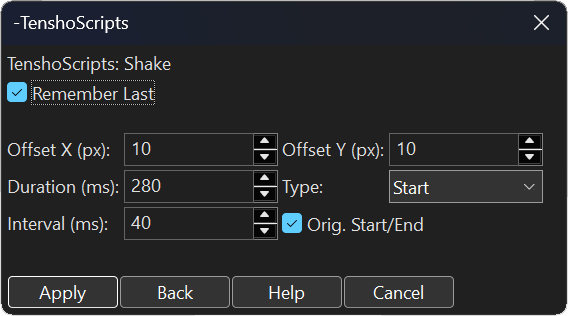

### How the buttons work:
* **Offset X and Y (px):** The maximum pixels the text can jump sideways (X) and up/down (Y).
* **Duration (ms):** The total time the shake will last.
* **Interval (ms):** The frequency. A low interval (e.g., `40`) makes a fast and violent shake, a high interval makes a slow rocking motion.
* **Type:** When the shake happens: **Start** (only in the first *Duration* ms), **End** (only in the last *Duration* ms), **Both**, or **Always** (the whole line).
* **Orig. Start/End:** Keeps the text at its original position in the very first and very last moment of the shaking, so it never starts or ends displaced.
* The line needs a `\pos` or `\move`; if it has none, the script reads the position from the style. A `\fad` is converted automatically so the fade keeps working on each slice.

---

## 11. Color Tracker
*(Original base credits: [Zahuczky](https://github.com/Zahuczky/Zahuczkys-Aegisub-Scripts))*

A continuous "eyedropper". It tracks (follows) the color changes of a single specific pixel on your screen and applies that color to your subtitle.

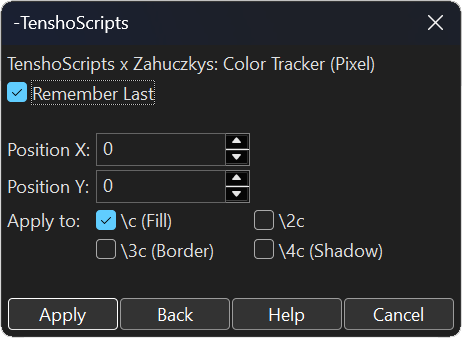

### How the buttons work:
* **Position X and Y:** The exact point of the **video** (in video pixels) the script will watch. It starts with the position of the first selected line.
* **Apply to:** Choose which part of your text will receive this tracked color from the video:
  * `\c (Fill)`: The inside of the text.
  * `\2c`: The secondary (karaoke) color.
  * `\3c (Border)`: The border.
  * `\4c (Shadow)`: The shadow.
* **Smooth transition between frames:** Blends the color from one frame to the next instead of switching it at once. Keep it on if the video you export has a higher frame rate than the project (for example, a YouTube render), otherwise the color looks choppy.

**Requirements:** a video loaded in Aegisub. If your Aegisub cannot read frames by itself, the script uses `ffmpeg`, which must be installed and available in your PATH.

---

## 12. Dynamic Glitch (Paid)
Creates the famous "Digital Failure" or Chromatic Aberration effect. It duplicates the text borders in different colors and makes them split and shake.

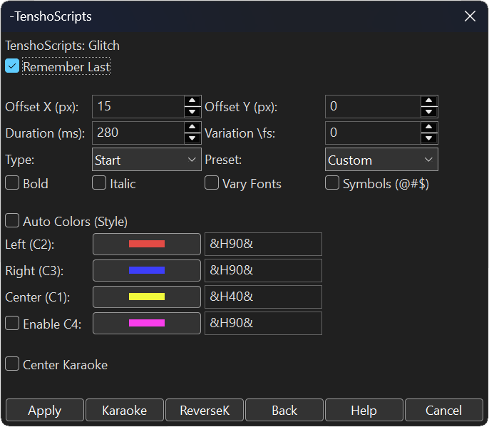

### How the buttons work:
* **Offset X and Y (px):** The maximum distance the fake colors will separate from the original text (sideways or up/down).
* **Duration (ms):** The time the effect will last on screen.
* **Variation \fs:** Makes the text size randomly "jump" (grow and shrink) during the glitch.
* **Type:** Choose if the glitch happens at the **Start** of the line, at the **End**, **Both**, or **Always** (the entire time).
* **Preset:** Ready-made settings (Timer 1, Timer 2, Opaque, Horizontal, Vertical, Chaos). Choose *Custom* to use your own values.
* **Karaoke / ReverseK buttons:** Use the `\k` timing of the line. With **Karaoke** the syllables appear one by one; with **ReverseK** they disappear one by one, in the rhythm of the `\k`.
* **Effect Checkboxes (Bold, Italic, Vary Fonts, Symbols):** Makes the text flicker by changing fonts or turning into random symbols (`@#$`) to look like a truly corrupted video file.
* **Auto Colors (Style):** Pulls the colors straight from your Aegisub Style. If unchecked, you can manually choose the color that will flash on the **Left**, **Right**, and **Center** of the text, along with their transparency (`Alpha`).
* **Center Karaoke:** If your glitch is happening syllable by syllable using the `\k` tag, this option ensures the word jumps to the center of the screen.

---

## 13. Rainbow Wave (Paid)
Makes color sweep across your text, letter by letter, without creating thousands of heavy overlapping layers. The window has two sections:

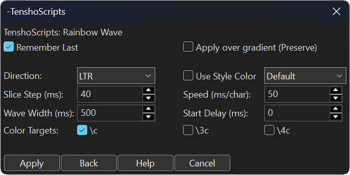

### Top section: Rainbow Wave (**Apply** button)
A rainbow (or a color from your style) passes through the text once.
* **Direction:** Where the wave travels (Left to Right, Right to Left, Middle to Out, Out to Middle).
* **Use Style Color + style:** Instead of the rainbow, the wave uses the colors of the chosen style, acting as a "glow" that sweeps through the text.
* **Slice Step (ms):** How often the color is updated (40 to 100). `40` is the smoothest; larger values create fewer lines.
* **Speed (ms/char):** The delay between one letter starting its color and the next one.
* **Wave Width (ms):** How long the color takes to pass through each letter.
* **Start Delay (ms):** Wait before the wave starts, counted from the beginning of the line.
* **Color Targets:** Apply the wave to the fill (`\c`), border (`\3c`) and/or shadow (`\4c`).
* **Apply over gradient (Preserve):** Keeps a gradient that already exists on the line and applies the wave on top of it.

### Bottom section: Abstract (**Abstract** button)
Instead of one rainbow passing once, bands of gradient made from **your palette** keep traveling along the text, one behind the other, until the end of the line.
* **Color 1 to 4 (left column):** The palette. The bands blend 1 → 2 → 3 → 4 → 1 in a loop.
* **Direction:** Which way the bands travel (Left to Right or Right to Left).
* **Size (letters):** Width of each band. Smaller = narrower bands and more colors on screen at once.
* **Speed (%):** How fast the bands move (`100` = half a palette cycle per second).
* **Waves:** Extra waviness of the bands (`1` = straight bands, up to `4` = more organic).
* This section also uses **Slice Step**, **Start Delay**, **Color Targets** and **Apply over gradient** from the top section.

**About `\fad`:** In both modes, a `\fad(in,out)` on the line is kept. Because the effect splits the line into many small lines, the script removes the `\fad` from each of them and calculates the `\alpha` of each piece so the fade looks exactly like the original.

---

## 14. KaraFX (Karaoke & ReverseK) [Paid]
Automates advanced effects for those who sync syllables using the `\k` tag. Replaces old karaoke plugins that used to break text layouts.

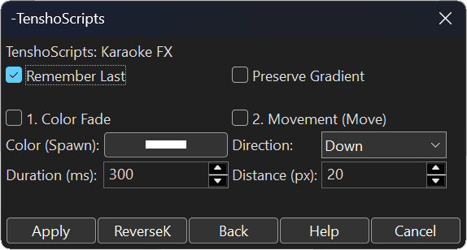

### How the buttons work:
* **1. Color Fade:** Makes the syllable change color *smoothly* when sung (unlike the hard, dry switch of normal karaoke). You set the Spawn Color and the time.
* **2. Movement (Move):** Makes the syllable give a little "jump" in the chosen direction (Down, Up, Left, Right) and the configured Distance in pixels as soon as it's sung.
* **3. Continuous Motion:** Each syllable keeps floating the whole time it stays on screen, independently of the others (a gentle bobbing, as in the "ambiente" reference). **Period (ms)** is the time of one full back-and-forth, **Amplitude X / Y (px)** is how far it sways (`0` disables that axis), and **Slice Step (ms)** is how often the position updates (lower = smoother, but more lines). **Choppy (random jumps)** replaces the smooth sway with jumps to a random position (within the amplitudes) that hold until the next step, like the reference GIF; use a Slice Step of 100-200 ms. **Min. jump (px)** forces each jump to be at least that far from the previous position, so YouTube does not drop jumps that are too small to notice (it cannot exceed what the amplitudes allow; `0` disables it). When this option is on, options 1 and 2 are ignored and the line's `\fad` is preserved. Period starts as the selected line's duration.
* **Duration (ms):** Time of the fade/entry animation. It opens with the **duration of the selected line**; type `0` to use each syllable's own `\k` time instead.
* **Preserve Gradient:** Ensures the above effects don't destroy your text's original gradient.
* **Lines per syllable:** each created line lasts only the time of its syllable (the animation cannot go past it), so only one or two lines are active at once and the file stays light. Example `{\k50}A {\k20}b{\k10}c` in ReverseK: line 1 (500 ms) fades `A` with `bc` visible; line 2 (200 ms) has `A` hidden and fades `b`; line 3 (100 ms) has `A b` hidden and fades `c`. Continuous Motion (option 3) still uses long lines, because each syllable keeps moving.
* **"ReverseK" Button (Reverse Karaoke):** Ignores the effects above and does the exact opposite of traditional karaoke: the entire text starts on screen and **vanishes** (dims) syllable by syllable in the exact rhythm of the `\k`.

---

## 15. Curves [Paid] - BETA
Brings the professional smooth movement of software like Premiere and After Effects straight into Aegisub's `\move` tag.

  <table>
    <tr>
      <td align="center" width="50%">
        <strong>Basic Mode</strong> 
        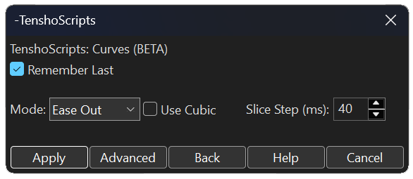
      </td>
      <td align="center" width="50%">
        <strong>Advanced Mode (Bézier)</strong> 
        
      </td>
    </tr>
  </table>

### How the buttons work:
* **Presets (In, Out, In-Out):** Ready-to-use accelerations. (Starts slow and ends fast, elastic bounce, etc.).
* **Advanced Mode (Bézier):** Allows you to paste the exact mathematical values (x1, y1, x2, y2) you use in your video editor so the text follows the exact same curve and speed as your camera.

## 16. Smart Translation [Paid]
Translates the selected lines with Gemini, sending the whole lyric together (plus the previous lines as context) so meaning, tone and pronouns stay consistent. Effects are kept.

* **Target Language:** language of the new text.
* **Context/style (optional):** a hint for the AI, e.g. `anime opening, informal, slang`.
* **Your own Gemini key (optional):** by default the tool uses the shared free quota (a daily character limit per license). If you hit the limit, or just prefer, paste your own free key from `aistudio.google.com/apikey`; it is saved only on your computer and is not counted in the shared quota.
* **Normal lines:** the initial tags (`\an`, `\pos`, `\fad`, colors...) are kept; tags in the middle of the text move along with the translation.
* **Karaoke lines (`\k`):** the translation is split into words (or characters in Japanese/Korean) and the original duration is redistributed over them, so the line still ends at the same moment. Per-syllable effects are stretched across the new text, but will not match the original syllable by syllable.
* **If it fails:** `quota` and `busy` messages mean the shared limit was reached (try later or use your own key).

 

  

 
 

  
Developed by <strong><a href="https://x.com/otenshy">Tensho</a></strong>. MIT License.

<h1 id="-português"></h1>

  

# Documentação Oficial: TenshoScripts v2.1.0

Bem-vindo ao manual de uso do **TenshoScripts**. Este pacote foi criado para facilitar a sua vida na hora de animar legendas. Nosso foco principal é agilizar e profissionalizar o workflow de legendas voltadas exclusivamente para o **YouTube**. O nosso script garante que as suas legendas nunca quebrem ou saiam do lugar enquanto você aplica efeitos complexos.

---

## 📑 Índice de Ferramentas

**⚙️ Configurações**
* [0. Configurações Globais](#0-configurações-globais)

**🟢 Ferramentas Gratuitas (Free)**
* [1. Fadeworks Adaptado](#1-fadeworks-adaptado)
* [2. Gradiente Fácil](#2-gradiente-fácil-multi-ponto)
* [3. Piscadas (Flashes)](#3-piscadas-flashes)
* [4. Dividir Linhas](#4-dividir-linhas)
* [5. Transformar (\t)](#5-transformar-t)
* [6. Texto & Fontes FX](#6-texto--fontes-fx)
* [7. Fixar Linhas](#7-fixar-linhas)
* [8. YtktFade](#8-ytktfade)
* [9. Contador](#9-contador-numérico)
* [10. Shake (Tremor)](#10-shake-tremor)
* [11. Color Tracker](#11-color-tracker)

**💎 TenshoScripts + (Exclusive)**
* [12. Glitch Dinâmico](#12-glitch-dinâmico-pago)
* [13. Onda Arco-Íris](#13-onda-arco-íris-pago)
* [14. KaraFX (Karaoke & KReverso)](#14-karafx-karaoke--kreverso-pago)
* [15. Curvas [BETA]](#15-curvas-pago---beta)

---

## 0. Configurações Globais
Onde você personaliza como o script se comporta no seu Aegisub.

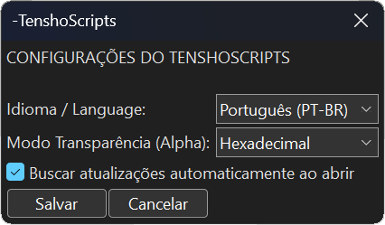

### Como funcionam as opções:
* **Idioma / Language:** Troca o idioma de todos os botões e avisos (Português ou Inglês).
* **Modo Transparência (Alpha):** Como você prefere digitar a transparência nas caixas de texto das ferramentas. Pode ser em código hexadecimal do Aegisub (ex: `&HFF&`) ou uma simples porcentagem de `0 a 100%`.
* **Buscar atualizações automaticamente:** Se marcado, o script olha na internet toda vez que você o abre para ver se tem funções novas e já baixa sozinho.

---

## 1. Fadeworks Adaptado
O Fadeworks serve para fazer o texto aparecer e sumir suavemente (Fade In / Fade Out).

### Como funcionam os botões:
* **Fade In / Fade Out:** O tempo que o texto vai demorar para aparecer no começo e sumir no final.
  * *Dica de Ouro:* Em vez de digitar milissegundos (ex: `500`), você pode digitar um valor decimal (como `0.8`). Isso fará o fade durar exatamente **80% do tempo total da linha**, não importa o tamanho dela!
* **Alpha / Colour:** Se escolher **Alpha**, o texto só fica transparente. Se escolher **Cor (From/To)**, o texto vai mudar de uma cor para outra enquanto aparece.
* **By Letter (Por Letra):** Em vez da linha inteira aparecer de uma vez, cada letra vai aparecendo uma após a outra.
* **Direção:** A ordem em que as letras aparecem (Esquerda para Direita, Direita para Esquerda, etc.).

---

## 2. Gradiente Fácil (Multi-Ponto)
Pinta a sua legenda com um degradê (várias cores se misturando na horizontal). Funciona perfeitamente mesmo selecionando várias linhas ao mesmo tempo.

  <table>
    <tr>
      <td align="center" width="50%">
        <strong>Gradiente Manual</strong> 
        
      </td>
      <td align="center" width="50%">
        <strong>Gradiente por Estilo</strong> 
        
      </td>
    </tr>
  </table>

### Como funcionam os botões:
* **Cores (1 a 5):** Escolha as cores que formarão o degradê.
* **Interpolar HSL:** Deixe marcado! Faz a mistura das cores ficar viva, sem criar manchas cinzas ou marrons no meio.
* **Aplicar em (Target):** Define se a cor vai pintar o interior do texto (`\c`), a borda (`\3c`) ou a sombra (`\4c`).
* **Aba de Estilos:** Permite criar o degradê puxando as cores prontas dos seus Estilos do Aegisub.

---

## 3. Piscadas (Flashes)
Faz a sua legenda piscar rapidamente em outra cor. Perfeito para dar impacto nas batidas fortes da música.

### Como funcionam os botões:
* **Cor do Flash:** A cor que o texto vai ficar quando "piscar".
* **Intervalo (ms):** A velocidade das piscadas. Menor = Mais rápido.
* **Suavizar Transição:** Se desmarcado, pisca de forma seca. Se marcado, a cor pulsa suavemente de uma para outra.
* **Aplicar em:** Qual cor recebe o flash: preenchimento (`\c`), secundária (`\2c`), borda (`\3c`) e/ou sombra (`\4c`).

---

## 4. Dividir Linhas
Corta uma frase inteira e transforma cada letra ou palavra em uma linha separada no Aegisub, sem tirar elas do lugar original. 

### Como funcionam os botões:
* **Dividir por Caractere:** Separa letra por letra.
* **Dividir por Palavra:** Separa cortando nos espaços.

---

## 5. Transformar (\t)
Anima a mudança de cores, tamanhos e transparência de um ponto ao outro de forma automática.

### Como funcionam os botões:
* **Início e Fim (ms):** O tempo exato em que a animação acontece. Se deixar o fim zerado, ele dura a linha toda.
* **Cores e Tamanho:** Marque o que você quer mudar e o valor final. (Ex: Marcar Fonte `\fs` para `150` fará o texto crescer até esse tamanho).

---

## 6. Texto & Fontes FX
Um gerador de animações de texto focadas em tipografia.

### Efeitos Disponíveis:
* **Variar Fontes:** Sorteia fontes aleatórias ajustando automaticamente o tamanho de cada uma para nenhuma ficar "espremida".
* **Typewriter (Máquina de Escrever):** O texto é digitado na tela.
* **Embaralhar (Hacking):** Mostra símbolos aleatórios rolando antes de revelar a letra verdadeira.
* **Caos:** Símbolos corrompidos aparecem e somem sozinhos.
* **Inverter:** Espelha a frase de trás pra frente.
* **Pulo Dinâmico (Centralizar):** Faz o texto sempre se reajustar pro meio da tela a cada letra digitada, sem empurrar o resto da frase.

---

## 7. Fixar Linhas
Converte as linhas selecionadas para coordenadas absolutas (`\pos`) e move todas para uma nova posição, mantendo a distância entre elas. Útil para reposicionar um grupo inteiro de linhas de uma vez.

### Como funcionam os botões:
* **Novo X / Novo Y (Âncora):** Onde a **linha de referência** deve ficar. A referência é a primeira linha selecionada (ou a primeira marcada como "Original"); a posição atual dela aparece abaixo dos campos. Todas as outras linhas selecionadas se movem pela mesma distância, então o desenho entre elas é preservado.
* **Forçar alinhamento (`\an5`):** Remove o `\an` existente e aplica `\an5` (centro) nas linhas, assim o X/Y digitado passa a ser o centro do texto.

---

## 8. YtktFade
Ferramenta para quem faz karaokê "invisível" focado pro YouTube. Prepara as linhas selecionadas adicionando a tag `\ytktFade` e deixando a cor secundária (`\2a&HFF&`) totalmente transparente, assim a parte ainda não cantada do texto fica escondida até ser cantada.

### Como funcionam os botões:
* **Ativar `\2c`:** Se marcado, também define a cor secundária (`\2c`) com a cor escolhida ao lado. Deixe desmarcado para manter o `\2c` atual da linha.
* Você pode rodar de novo nas mesmas linhas: o `\ytktFade` e o `\2a` anteriores são substituídos, não duplicados.

---

## 9. Contador Numérico
Gera números animados sozinhos. Ótimo para barras de progresso, carregamentos ou estatísticas na tela.

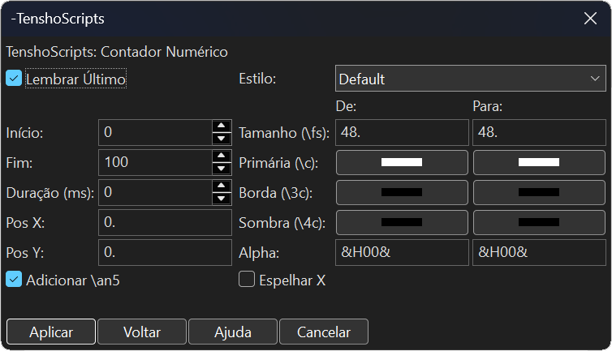

### Como funcionam os botões:
* **Início / Fim:** De qual número ele começa e em qual termina (Ex: 0 a 100).
* **Duração (ms):** Tempo que ele leva para contar. Se deixar `0`, ele conta durante todo o tempo da linha.
* **Pos X / Pos Y:** As coordenadas exatas na tela onde o contador vai aparecer.
* **Adicionar \an5:** Centraliza perfeitamente o número na posição escolhida.
* **De -> Para (Tamanho/Cores):** Você pode fazer o número crescer (Tamanho `\fs`), mudar de cor principal, borda, sombra ou ir aparecendo (Alpha) enquanto conta!

---

## 10. Shake (Tremor)
Faz a legenda tremer na tela, simulando o balanço de uma câmera. O script gera os movimentos automaticamente criando vários `\pos`.

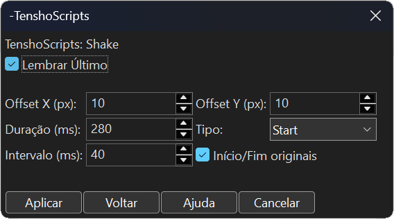

### Como funcionam os botões:
* **Offset X e Y (px):** O limite de pixels que o texto pode pular para os lados (X) e para cima/baixo (Y).
* **Duração (ms):** O tempo total que o tremor vai durar.
* **Intervalo (ms):** A frequência. Um intervalo baixo (ex: `40`) faz um tremor rápido e violento, um intervalo alto faz um balanço lento.
* **Tipo:** Quando o tremor acontece: **Start** (só nos primeiros *Duração* ms), **End** (só nos últimos *Duração* ms), **Both** (início e fim) ou **Always** (a linha toda).
* **Início/Fim originais:** Mantém o texto na posição original no primeiríssimo e no último instante do tremor, para ele nunca começar ou terminar deslocado.
* A linha precisa ter `\pos` ou `\move`; se não tiver, o script lê a posição do estilo. Um `\fad` é convertido automaticamente para o fade continuar funcionando em cada fatia.

---

## 11. Color Tracker
*(Créditos da base original: [Zahuczky](https://github.com/Zahuczky/Zahuczkys-Aegisub-Scripts))*

Um "conta-gotas" contínuo. Ele fica rastreando (seguindo) as mudanças de cor de um único pixel da tela e aplica essa cor na sua legenda.

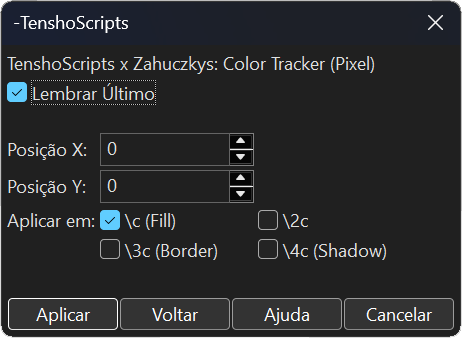

### Como funcionam os botões:
* **Posição X e Y:** O ponto exato do **vídeo** (em pixels do vídeo) que o script vai vigiar. Começa com a posição da primeira linha selecionada.
* **Aplicar em:** Escolha que parte do seu texto vai receber essa cor copiada do vídeo:
  * `\c (Fill)`: O interior do texto.
  * `\2c`: A cor secundária (karaokê).
  * `\3c (Border)`: A borda.
  * `\4c (Shadow)`: A sombra.
* **Transição suave entre frames:** Mistura a cor de um frame para o outro em vez de trocar de uma vez. Deixe ligado se o vídeo que você exporta tiver mais fps que o projeto (por exemplo, um render para o YouTube); senão a cor fica travada.

**Requisitos:** um vídeo carregado no Aegisub. Se o seu Aegisub não consegue ler os frames sozinho, o script usa o `ffmpeg`, que precisa estar instalado e no PATH.

---

## 12. Glitch Dinâmico (Pago)
Cria o famoso efeito de "Falha Digital" ou Aberração Cromática. Ele duplica as bordas do texto em cores diferentes e faz elas se separarem e tremerem.

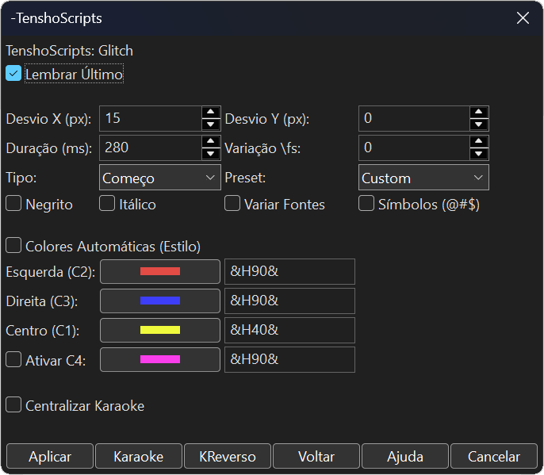

### Como funcionam os botões:
* **Desvio X e Y (px):** A distância máxima que as cores falsas vão se separar do texto original (para os lados ou para cima/baixo).
* **Duração (ms):** O tempo que o efeito vai durar na tela.
* **Variação \fs:** Faz o tamanho do texto "pular" (aumentar e diminuir) aleatoriamente durante o glitch.
* **Tipo:** Escolha se o glitch acontece no **Começo** da linha, no **Fim**, em **Ambos**, ou **Sempre** (o tempo todo).
* **Preset:** Configurações prontas (Timer 1, Timer 2, Opaco, Horizontal, Vertical, Caos). Escolha *Custom* para usar os seus próprios valores.
* **Botões Karaoke / KReverso:** Usam o tempo do `\k` da linha. Com **Karaoke** as sílabas aparecem uma a uma; com **KReverso** elas somem uma a uma, no ritmo do `\k`.
* **Caixinhas de Efeito (Negrito, Itálico, Variar Fontes, Símbolos):** Fazem o texto piscar trocando de fonte ou virando símbolos aleatórios (`@#$`) para parecer que o arquivo de vídeo corrompeu de verdade.
* **Cores Automáticas (Estilo):** Puxa as cores direto do seu Estilo do Aegisub. Se desmarcar, você pode escolher manualmente a cor que vai piscar na **Esquerda**, **Direita** e no **Centro** do texto, junto com a transparência (`Alpha`) de cada uma.
* **Centralizar Karaoke:** Se o seu glitch estiver acontecendo sílaba por sílaba com a tag `\k`, essa opção garante que a palavra pule para o centro da tela.

---

## 13. Onda Arco-Íris (Pago)
Faz cor varrer o seu texto, letra por letra, sem criar milhares de camadas pesadas. A janela tem duas seções:

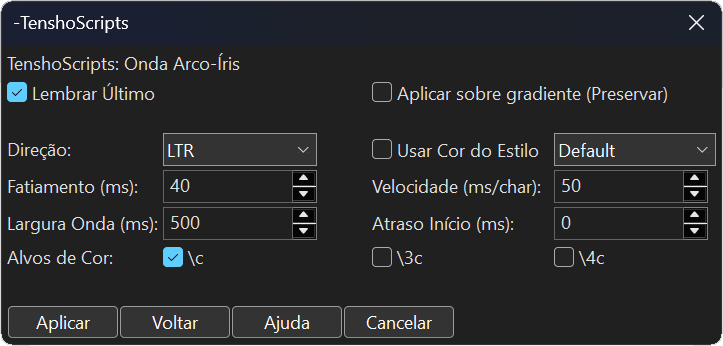

### Seção de cima: Onda Arco-Íris (botão **Aplicar**)
Um arco-íris (ou uma cor do seu estilo) passa pelo texto uma vez.
* **Direção:** Para onde a onda vai (Esquerda para Direita, Direita para Esquerda, Meio para Fora, Fora para Meio).
* **Usar Cor do Estilo + estilo:** Em vez do arco-íris, a onda usa as cores do estilo escolhido, servindo como um "brilho" que atravessa o texto.
* **Fatiamento (ms):** De quanto em quanto tempo a cor é atualizada (40 a 100). `40` é o mais macio; valores maiores geram menos linhas.
* **Velocidade (ms/char):** O atraso entre uma letra começar a mudar de cor e a próxima começar.
* **Largura da Onda (ms):** Quanto tempo a cor leva para passar por cada letra.
* **Atraso Início (ms):** Espera antes de a onda começar, contada a partir do início da linha.
* **Alvos de Cor:** Aplica a onda no preenchimento (`\c`), na borda (`\3c`) e/ou na sombra (`\4c`).
* **Aplicar sobre gradiente (Preservar):** Mantém um degradê que já existe na linha e aplica a onda por cima.

### Seção de baixo: Abstrato (botão **Abstrato**)
Em vez de um arco-íris passando uma vez, faixas de gradiente feitas com a **sua paleta** ficam percorrendo o texto, uma atrás da outra, até o fim da linha.
* **Cor 1 a 4 (coluna da esquerda):** A paleta. As faixas se misturam 1 → 2 → 3 → 4 → 1 em loop.
* **Direção:** Para onde as faixas andam (Esquerda para Direita ou Direita para Esquerda).
* **Tamanho (letras):** Largura de cada faixa. Menor = faixas mais estreitas e mais cores na tela ao mesmo tempo.
* **Velocidade (%):** Quão rápido as faixas andam (`100` = meio ciclo da paleta por segundo).
* **Ondas:** Ondulação extra das faixas (`1` = faixas retas, até `4` = mais orgânicas).
* Esta seção também usa **Fatiamento**, **Atraso Início**, **Alvos de Cor** e **Aplicar sobre gradiente** da seção de cima.

**Sobre o `\fad`:** Nos dois modos, o `\fad(in,out)` da linha é mantido. Como o efeito divide a linha em várias linhas pequenas, o script remove o `\fad` de cada uma e calcula o `\alpha` de cada pedaço, para o fade ficar igual ao original.

---

## 14. KaraFX (Karaoke & KReverso) [Pago]
Automatiza efeitos avançados para quem sincroniza sílabas usando a tag `\k`. Substitui plugins velhos de karaokê que quebravam o layout do texto.

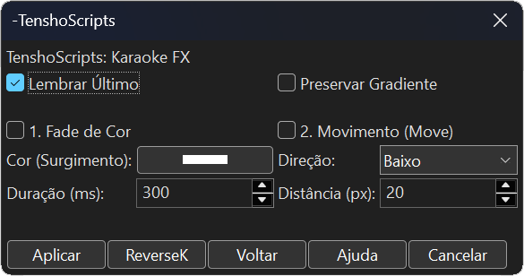

### Como funcionam os botões:
* **1. Fade de Cor:** Faz a sílaba mudar de cor *suavemente* quando for cantada (diferente da troca dura e seca do karaokê normal). Você define a Cor do Surgimento e o tempo.
* **2. Movimento (Move):** Faz a sílaba dar um "pulinho" na direção escolhida (Baixo, Cima, Esquerda, Direita) e na Distância configurada em pixels assim que for cantada.
* **3. Movimento Contínuo:** Cada sílaba fica flutuando o tempo todo em que está na tela, independente das outras (um balanço suave, como na referência do "ambiente"). **Período (ms)** é o tempo de uma ida e volta completa, **Amplitude X / Y (px)** é o quanto ela balança (`0` desliga aquele eixo) e **Fatiamento (ms)** é de quanto em quanto tempo a posição atualiza (menor = mais macio, porém mais linhas). **Travado (saltos aleatórios)** troca o balanço suave por saltos para uma posição aleatória (dentro das amplitudes) que fica parada até o próximo passo, como no GIF de referência; use Fatiamento de 100-200 ms. **Salto mínimo (px)** obriga cada salto a ficar pelo menos essa distância da posição anterior, para o YouTube não descartar saltos pequenos demais (não passa do que as amplitudes permitem; `0` desliga). Com esta opção ligada, as opções 1 e 2 são ignoradas e o `\fad` da linha é preservado. O Período começa com a duração da linha selecionada.
* **Duração (ms):** Tempo da animação de fade/entrada. Abre com a **duração da linha selecionada**; digite `0` para usar o tempo do `\k` de cada sílaba.
* **Linhas por sílaba:** cada linha criada dura só o tempo da sílaba (a animação não passa disso), então só uma ou duas linhas ficam ativas ao mesmo tempo e o arquivo fica leve. Exemplo `{\k50}A {\k20}b{\k10}c` no ReverseK: a linha 1 (500 ms) apaga o `A` com `bc` visíveis; a linha 2 (200 ms) tem `A` oculto e apaga o `b`; a linha 3 (100 ms) tem `A b` ocultos e apaga o `c`. O Movimento Contínuo (opção 3) continua com linhas longas, porque cada sílaba segue se mexendo.
* **Preservar Gradiente:** Garante que os efeitos acima não destruam o degradê original do seu texto.
* **Botão "KReverso" (Karaokê Reverso):** Ignora os efeitos acima e faz o oposto do karaokê tradicional: o texto inteiro começa na tela e vai **apagando** (sumindo) sílaba por sílaba no exato ritmo do `\k`.

---

## 15. Curvas [Pago] - BETA
Traz a movimentação suave profissional de programas como Premiere e After Effects direto para a tag `\move` do Aegisub.

  <table>
    <tr>
      <td align="center" width="50%">
        <strong>Modo Básico</strong> 
        
      </td>
      <td align="center" width="50%">
        <strong>Modo Avançado (Bézier)</strong> 
        
      </td>
    </tr>
  </table>

### Como funcionam os botões:
* **Presets (In, Out, In-Out):** Acelerações prontas. (Começa devagar e termina rápido, dá um tranco elástico, etc).
* **Modo Avançado (Bézier):** Permite colar os valores matemáticos exatos (x1, y1, x2, y2) que você usa na edição do seu vídeo, pro texto andar e frear na exata mesma velocidade da câmera.

## 16. Tradução Inteligente [Pago]
Traduz as linhas selecionadas com o Gemini, enviando a letra inteira junta (mais as linhas anteriores como contexto) para manter sentido, tom e pronomes consistentes. Os efeitos são preservados.

* **Idioma de Destino:** idioma do novo texto.
* **Contexto/estilo (opcional):** uma dica para a IA, por exemplo `abertura de anime, informal, gírias`.
* **Chave Gemini própria (opcional):** por padrão a ferramenta usa a cota gratuita compartilhada (um limite diário de caracteres por licença). Se atingir o limite, ou se preferir, cole sua chave gratuita de `aistudio.google.com/apikey`; ela fica salva só no seu computador e não conta na cota compartilhada.
* **Linhas normais:** as tags iniciais (`\an`, `\pos`, `\fad`, cores...) são mantidas; tags no meio do texto acompanham a tradução.
* **Linhas de karaokê (`\k`):** a tradução é dividida em palavras (ou caracteres em japonês/coreano) e a duração original é redistribuída sobre elas, então a linha termina no mesmo instante. Efeitos por sílaba são esticados sobre o texto novo, mas não ficam iguais ao original sílaba por sílaba.
* **Se falhar:** as mensagens `quota` e `busy` indicam que o limite compartilhado foi atingido (tente mais tarde ou use sua chave).

 

  

 

 

  
Desenvolvido por <strong><a href="https://x.com/otenshy">Tensho</a></strong>. MIT License.

